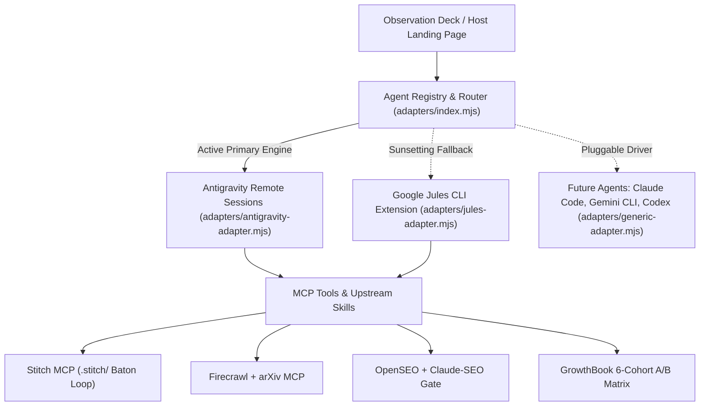

# SEO Agent Hub (`seo-agent-hub`)

> **Declarative Model Context Protocol (MCP) & GrowthBook 6-Cohort A/B Stack with a Universal Agent Adapter Layer (`Antigravity Remote Sessions` as Active Primary, `Google Jules` Sunsetting Fallback, and Pluggable Multi-Agent Drivers).**

---

## 1. Architectural Refactor: Universal Agent Adapter Layer

To de-risk the ecosystem against agent sunsets (such as the impending **Google Jules deprecation/sunset**), `seo-agent-hub` decouples orchestration into a **Pluggable Agent Adapter Layer** ([`./adapters/`](./adapters/index.mjs)):



### Registered Adapters
| Adapter Identifier | Engine Type | Lifecycle Status | Role in Hub |
|---|---|---|---|
| **`antigravity`** | `remote_session` | **`active_primary`** | Primary production execution engine utilizing Antigravity remote sessions, subagent orchestration, and parallel MCP tool execution. |
| **`jules`** | `cli_extension` | **`sunsetting`** | Legacy Google Jules integration (`gemini-cli-extensions/jules`). Emits deprecation notices and automatically fails over to Antigravity without service interruption. |
| **`extensible_agents`** | `pluggable_driver` | **`extensible`** | Zero-downtime driver architecture to plug in additional agent engines (e.g. Anthropic Claude Code, Gemini CLI, Codex, OpenOperator) via [`./adapters/generic-adapter.mjs`](./adapters/generic-adapter.mjs). |

---

## 2. Upstream Open-Source Skills & MCP Registry

Instead of custom scrapers, custom SEO linters, or hand-written `SKILL.md` rewrites, `seo-agent-hub` vendors and binds **11 established open-source MCP servers and agent skill repositories** directly inside [`./skills/`](./skills/mcp-registry.json):

| System Layer | Cloned Upstream Public Repositories (`./skills/`) | Primary Operator | Role in the Loop |
|---|---|---|---|
| **Agent Execution** | [`adapters/`](./adapters/) + [`skills/jules-extension`](https://github.com/gemini-cli-extensions/jules) | **Antigravity** (Primary) / **Jules** (Sunset Fallback) | Universal Agent Adapter managing multi-agent dispatch and failover |
| **Web Reconnaissance** | [`firecrawl/skills`](https://github.com/firecrawl/skills) (`./skills/firecrawl-skills`)<br>[`firecrawl/firecrawl-mcp-server`](https://github.com/firecrawl/firecrawl-mcp-server) (`./skills/firecrawl-mcp-server`) | **Research Agent** (via Adapter) | Competitor intelligence (`firecrawl-competitive-intel`), research paper scraping, and lead discovery |
| **Academic Discovery** | [`blazickjp/arxiv-mcp-server`](https://github.com/blazickjp/arxiv-mcp-server) (`./skills/arxiv-mcp-server`) | **Research Agent** (via Adapter) | Queries arXiv for peer-reviewed clinical & engineering benchmarks (`search_papers`, `read_paper`) |
| **Page & Variant Creation** | [`google-labs-code/stitch-skills`](https://github.com/google-labs-code/stitch-skills) (`./skills/stitch-skills`)<br>[`davideast/stitch-mcp`](https://github.com/davideast/stitch-mcp) (`./skills/stitch-mcp`)<br>[`Kargatharaakash/stitch-mcp`](https://github.com/Kargatharaakash/stitch-mcp) (`./skills/stitch-mcp-server`) | **Appearance Agent** + **Stitch MCP** | **Strictly generates pages and cohort variants** via the official `.stitch/next-prompt.md` baton protocol |
| **SEO & AEO Validation Gate** | [`every-app/open-seo`](https://github.com/every-app/open-seo) (`./skills/open-seo`)<br>[`AgriciDaniel/claude-seo`](https://github.com/AgriciDaniel/claude-seo) (`./skills/claude-seo`)<br>[`Bhanunamikaze/Agentic-SEO-Skill`](https://github.com/Bhanunamikaze/Agentic-SEO-Skill) (`./skills/agentic-seo-skill`)<br>[`Ryze-AI-Adgent/open-seo-mcp-skills`](https://github.com/Ryze-AI-Adgent/open-seo-mcp-skills) (`./skills/open-seo-mcp-skills`) | **Validation Gate Agent** (via Adapter) | Audits Stitch-generated pages (`openseo_score >= 88`), JSON-LD schema, and Answer Engine `/llms.txt` + `/robots.txt` |
| **Client-Side 6-Cohort A/B Testing** | **GrowthBook JS SDK** (`./sdk/growthbook-ab.js`) | **GrowthBook Auto-Wrapper** | Zero-backend client-side DOM swaps & conversion tracking across `18-24` (primary), `25-34`, `35-44`, `45-54`, `55-64`, `65+` |
| **Orchestration & Observation Deck** | SQLite WAL + Observation Deck (`./dashboard/`) | **Universal Orchestrator** | Dynamic adapter switching (`/api/adapters/select`), conversational steering bridge, live page preview, and `CanNotDelete`-locked SQLite state |

---

## 3. Declarative Repository Blueprint

```text
seo-agent-hub/
├── init                          # Minimal 5-step setup wrapper (Universal Adapter handshake)
├── .env.example                  # Environment variable template (PRIMARY_AGENT_ADAPTER=antigravity)
├── adapters/                     # Universal Pluggable Agent Adapter Layer
│   ├── base-adapter.mjs          # BaseAgentAdapter contract
│   ├── antigravity-adapter.mjs   # Antigravity Remote Sessions (Active Primary)
│   ├── jules-adapter.mjs         # Google Jules CLI (Sunsetting Fallback)
│   ├── generic-adapter.mjs       # Pluggable driver for future agents (Claude Code, Gemini CLI, etc.)
│   └── index.mjs                 # AgentRegistry & Router with dynamic failover
├── .stitch/                      # Official google-labs-code/stitch-skills baton directory
│   ├── DESIGN.md                 # Stitch Project 503366360860058565 ("Clinical Vitality") design tokens
│   ├── SITE.md                   # Site vision, sitemap of generated pages, and roadmap
│   ├── metadata.json             # Stitch screen IDs, dimensions, and cohort mappings
│   ├── next-prompt.md            # Active baton prompt consumed by Stitch Loop
│   └── designs/                  # Staged HTML screens synthesized by Stitch MCP
├── config/
│   ├── agents.manifest.json      # Universal Agent Adapter manifest (Primary + Sunsetting + Roles)
│   ├── jules.manifest.json       # Backwards-compatible manifest pointing to agents.manifest.json
│   ├── stitch.mcp.json           # @_davideast/stitch-mcp proxy & .stitch/ baton configuration
│   ├── antigravity.routing.yaml  # Adapter policy & multi-agent routing
│   └── sqlite.schema.sql         # SQLite WAL schema + SEC-04 CanNotDelete triggers
├── agents/
│   ├── orchestrator.md           # Universal Core Orchestrator system prompt
│   ├── research.md               # Firecrawl + arXiv Reconnaissance system prompt
│   ├── validation.md             # OpenSEO + claude-seo + llms.txt Validation Gate prompt
│   └── appearance.md             # Stitch Page Generator + GrowthBook cohort routing prompt
├── skills/                       # 11 Cloned Public Repositories (no custom rewrites)
│   ├── mcp-registry.json         # Declarative registry mapping all cloned repos & SKILL.md paths
│   ├── open-seo/                 # Cloned from every-app/open-seo
│   ├── open-seo-mcp-skills/      # Cloned from Ryze-AI-Adgent/open-seo-mcp-skills
│   ├── claude-seo/               # Cloned from AgriciDaniel/claude-seo
│   ├── agentic-seo-skill/        # Cloned from Bhanunamikaze/Agentic-SEO-Skill
│   ├── firecrawl-skills/         # Cloned from firecrawl/skills
│   ├── firecrawl-mcp-server/     # Cloned from firecrawl/firecrawl-mcp-server
│   ├── stitch-skills/            # Cloned from google-labs-code/stitch-skills
│   ├── stitch-mcp/               # Cloned from davideast/stitch-mcp
│   ├── stitch-mcp-server/        # Cloned from Kargatharaakash/stitch-mcp
│   ├── arxiv-mcp-server/         # Cloned from blazickjp/arxiv-mcp-server
│   └── jules-extension/          # Cloned from gemini-cli-extensions/jules
├── sdk/
│   ├── growthbook-ab.js          # Single-tag GrowthBook 6-cohort client injection script
│   └── generated-pages/          # Production HTML pages generated via Stitch MCP
├── dashboard/
│   ├── server.mjs                # Node 24 Observation Deck & Adapter Router server
│   ├── index.html                # Unified Observation Deck UI + Adapter Switcher Deck
│   └── chainlit_app.py           # Optional Chainlit Python UI adapter
└── tests/
    └── e2e.test.mjs              # Automated E2E verification suite (Adapters + Stitch + 6-Cohort A/B)
```

---

## 4. Quickstart: Fork, Initialize & Inject in 60 Seconds

### Step 1: Clone & Run `./init`
```bash
git clone https://github.com/AhmedNasser-bug/seo-agent-hub.git
cd seo-agent-hub
cp .env.example .env
./init --daemon
```

What `./init` executes sequentially:
1. **Agent Adapter Handshake**: Provisions the Universal Agent Adapter Layer, designating **Antigravity Remote Sessions** as `active_primary` and exporting Jules sunset configurations with graceful failover.
2. **Stitch MCP Universal Binding**: Binds `@_davideast/stitch-mcp` (`./skills/stitch-mcp`) and `./skills/stitch-skills` to the adapter layer for Project `503366360860058565` using `.stitch/next-prompt.md`.
3. **Pluggable Runtime Routing**: Generates `./state/runtime.routing.json` mapping research, appearance, and validation tasks to the active adapter.
4. **Cloned Skills Verification & SQLite Provisioning**: Verifies all 11 cloned upstream skill repositories in `./skills/` and provisions `./state/seo_hub.db` with `CanNotDelete` resource locks (`SEC-04`).
5. **Observation Deck Launch & Snippet Output**: Starts the Observation Deck on `http://localhost:4325` and outputs the single HTML `<script>` tag for your host landing page.

### Step 2: Paste the Single Script Tag into Your Host Landing Page `<head>`
```html
<script
  src="http://localhost:4325/sdk/growthbook-ab.js"
  data-seo-hub="http://localhost:4325"
  data-client-key="sdk-pharos-clinical-2026"
  data-default-cohort="18-24"
  defer
></script>
```

---

## 5. Dynamic Agent Switching & Adding Future Agents

### Switch Active Agent at Runtime
In the Observation Deck UI (`http://localhost:4325`) or via API:
```bash
# Switch to Antigravity Remote Sessions (Primary)
curl -X POST http://localhost:4325/api/adapters/select -H "Content-Type: application/json" -d '{"adapter": "antigravity"}'

# Switch to Google Jules (Sunsetting)
curl -X POST http://localhost:4325/api/adapters/select -H "Content-Type: application/json" -d '{"adapter": "jules"}'
```

### Adding a New Agent Driver
To add a new agent (e.g. `claude-code`, `gemini-cli`, or a custom in-house agent), simply register an instance of `GenericAgentAdapter` in `adapters/index.mjs`:
```javascript
import { agentRegistry, GenericAgentAdapter } from './adapters/index.mjs';

agentRegistry.register(new GenericAgentAdapter({
  name: 'claude-code',
  displayName: 'Anthropic Claude Code CLI',
  type: 'cli_runner',
  handler: async ({ role, message, context }) => {
    // Custom dispatch logic
    return { adapter: 'claude-code', role, reply: 'Processed via Claude Code' };
  }
}));
```

---

## 6. Reference Case Study: Pharos University Hemodialysis Platform (`Grad_project_landing`)

This stack was built, tested, and verified live on **[`AhmedNasser-bug/Grad_project_landing`](https://github.com/AhmedNasser-bug/Grad_project_landing)** — the **Dual-Shield Clinical AI Hemodialysis Safety Platform** developed at Pharos University in Alexandria.

### Pages Created via Stitch MCP & Active Agent Adapter:
1. **Cohort `18-24` (Primary Testing Cohort)**: [`medgemma-cpoe-idh-prediction-2026.html`](./sdk/generated-pages/medgemma-cpoe-idh-prediction-2026.html) — *Predicting Intradialytic Hypotension 22 Minutes Before Collapse with MedGemma-4B* (OpenSEO: **96/100**).
2. **Cohort `35-44` (Attending Nephrologists)**: [`nephrology-ward-cpoe-override-audit-2026.html`](./sdk/generated-pages/nephrology-ward-cpoe-override-audit-2026.html) — *Zero-Override Dialysis Ward Protocol: Cutting Alert Fatigue by 64% with Dual-Shield AI* (OpenSEO: **98/100**).
3. **Cohort `25-34` (Clinical Engineering Residents)**: [`edge-onnx-dialysis-telemetry-benchmarks-2026.html`](./sdk/generated-pages/edge-onnx-dialysis-telemetry-benchmarks-2026.html) — *Quantized ONNX Runtime Inference on Bedside Embedded SoCs for Zero-Cloud Telemetry* (OpenSEO: **98/100**).

---

## 7. Automated Test Suite

```bash
node --test tests/e2e.test.mjs
```
Runs 5 comprehensive test suites:
- Cloned upstream skill repositories verification
- Universal Agent Adapter: Antigravity primary, Jules sunsetting, and dynamic switching
- Data-driven page generation via Stitch MCP baton loop
- Six-cohort GrowthBook A/B routing & conversion tracking
- Orchestrator conversational steering & WAF `SEC-04` CanNotDelete resource lock
